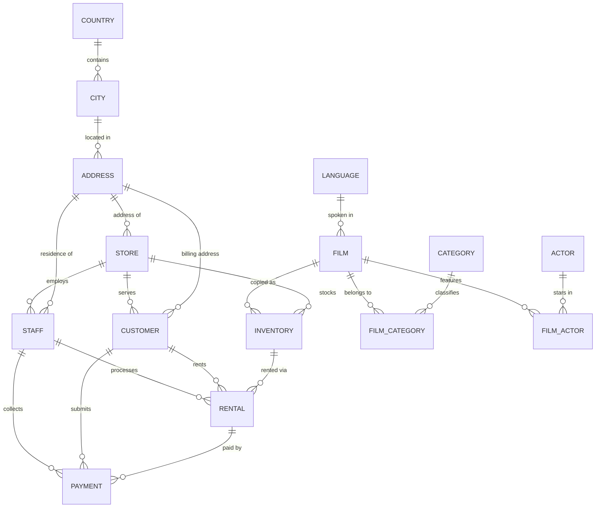

# SQL Database Validation & Business Analytics Framework: Pagila (PostgreSQL)

A production-grade SQL test automation framework and analytical reporting suite targeting the **PostgreSQL 16** [Pagila](https://github.com/devrimgunduz/pagila) DVD-rental business database.

This project demonstrates database validation testing, referential integrity assertions, business rule enforcement, deliberate defect injection and rollback, and advanced analytical SQL queries (CTEs, Window Functions, and Multi-Table Joins).

---

## 🌟 Key Capabilities & Highlights

- **Dual Database Execution Engine**:
  - **Docker Compose**: One-command initialization of PostgreSQL 16 container with automated entrypoint schema and seed initialization.
  - **Embedded In-Memory Engine**: Built-in zero-dependency runner using `@electric-sql/pglite` (WebAssembly PostgreSQL 16.2), allowing tests to run instantly on any machine without Docker or local database installs.
- **Data Quality Validation Suite**: 7 automated integrity checks designed to return **0 rows** when clean.
- **Defect Injection & Rollback**: `inject-defects.sql` introduces realistic transactional, temporal, and referential anomalies, proving that validation rules catch real data errors, followed by `rollback-defects.sql` to restore clean state.
- **30+ Advanced SQL Queries**: Categorized into Filtering/Sorting, Multi-Table Joins, Aggregations & Grouping, Subqueries, CTEs, and Window Functions (`LAG`, `LEAD`, `DENSE_RANK`, `ROW_NUMBER`, `NTILE`).
- **Executive Business Reports**: Revenue per store, top customers by lifetime spend, most-rented films, and films never rented.
- **Automated CLI Runner**: `npm run validate` outputs colorized ASCII tables, execution duration metrics, and automated exit codes for CI/CD pipelines.

---

## 🗺️ Entity-Relationship Diagram (ERD)



---

## 📁 Repository Structure

```text
04-sql-pagila-validation/
├── docker-compose.yml                    # PostgreSQL 16 container definition
├── package.json                          # Scripts & dependencies (pg, @electric-sql/pglite, dotenv)
├── .env.example                          # Database connection template
├── .gitignore                            # Ignores node_modules, .env, and large SQL dumps
├── README.md                             # Comprehensive technical documentation
├── sql/
│   ├── 00-init/                          # Automated database entrypoint scripts
│   │   ├── 01-schema.sql                 # DDL: 15 tables, keys, indexes, and custom enums
│   │   └── 02-seed-data.sql              # Clean baseline dataset for testing
│   ├── 01-queries/                       # 31 Advanced business queries
│   │   ├── 01-filtering-sorting.sql      # Q01 - Q05: WHERE, BETWEEN, ILIKE, LIMIT/OFFSET
│   │   ├── 02-joins.sql                  # Q06 - Q10: INNER, LEFT, FULL OUTER, SELF JOIN
│   │   ├── 03-aggregations-grouping.sql  # Q11 - Q15: COUNT, SUM, AVG, GROUP BY, HAVING
│   │   ├── 04-subqueries.sql             # Q16 - Q20: IN, NOT IN, EXISTS, Correlated subqueries
│   │   ├── 05-ctes.sql                   # Q21 - Q25: Multiple & Recursive CTEs
│   │   └── 06-window-functions.sql       # Q26 - Q31: DENSE_RANK, RANK, ROW_NUMBER, LAG, LEAD
│   ├── 02-business-reports/              # 4 Executive business reports
│   │   ├── 01-revenue-per-store.sql      # Total revenue and market share by store
│   │   ├── 02-top-customers.sql          # VIP customer spend and rental frequency
│   │   ├── 03-most-rented-films.sql      # Film popularity ranking and category revenue
│   │   └── 04-films-never-rented.sql     # Inventory titles with zero rental history
│   ├── 03-validations/                   # Data quality rules (Expected 0 rows on clean data)
│   │   ├── val01-orphan-rentals.sql      # Referential integrity checks
│   │   ├── val02-return-before-rental.sql# Temporal consistency (return_date >= rental_date)
│   │   ├── val03-negative-payments.sql   # Financial integrity (amount > 0)
│   │   ├── val04-duplicate-emails.sql    # Customer uniqueness constraint
│   │   ├── val05-overlapping-rentals.sql # Inventory collision checks
│   │   ├── val06-orphan-payments.sql     # Payment-to-customer matching validation
│   │   └── val07-invalid-ratings.sql     # MPAA rating domain check
│   └── 04-defects/
│       ├── inject-defects.sql            # Deliberate defect injection script
│       └── rollback-defects.sql          # Rollback & database cleansing script
└── src/
    ├── db.js                             # Unified DB connector (Docker / Local / Embedded)
    ├── runner.js                         # Automated validation runner & report generator
    └── download-pagila.js                # Official 13MB Pagila dump downloader
```

---

## 🚀 Getting Started & Execution

### 1. Installation
```powershell
cd 04-sql-pagila-validation
npm install
```

### 2. Execution Modes

The framework supports two execution methods:

#### Method A: Zero-Install Standalone Mode (Default)
Run tests directly using the embedded PostgreSQL 16 engine:
```powershell
npm test
```

#### Method B: Docker Container Mode
Start PostgreSQL 16 in Docker:
```powershell
docker-compose up -d
npm test
```

---

## 🧪 NPM Scripts Catalog

| Script | Command | Description |
| :--- | :--- | :--- |
| **Full Lifecycle Test** | `npm test` or `npm run validate` | Runs Clean validation $\rightarrow$ Injects defects $\rightarrow$ Verifies defect detection $\rightarrow$ Rolls back $\rightarrow$ Verifies clean data $\rightarrow$ Runs Business Reports |
| **Clean Data Only** | `npm run validate:clean` | Runs all 7 validation rules against current clean data (asserts 0 rows, exit 0) |
| **Defect Injection Only** | `npm run validate:defects` | Injects anomalies and asserts that the suite flags all defects |
| **Download Full Dump** | `npm run download:dump` | Streams the official 13MB Pagila dump (16,000+ rentals) from GitHub |

---

## 🔍 Data Quality Validation Rules

All validation rules follow the **zero-row assertion pattern**: if the data is compliant, the query yields exactly `0` rows. Any rows returned indicate a defect.

| Rule ID | File | Focus Area | Anomaly Condition Checked |
| :--- | :--- | :--- | :--- |
| **VAL-01** | `val01-orphan-rentals.sql` | Referential Integrity | Rentals referencing missing `customer_id`, `inventory_id`, or `staff_id`. |
| **VAL-02** | `val02-return-before-rental.sql` | Temporal Consistency | Rentals with `return_date < rental_date` (impossible return timestamp). |
| **VAL-03** | `val03-negative-payments.sql` | Financial Integrity | Transactions with `amount <= 0` or `NULL` payment values. |
| **VAL-04** | `val04-duplicate-emails.sql` | Identity Uniqueness | Multiple customer accounts sharing the same email address. |
| **VAL-05** | `val05-overlapping-rentals.sql` | Business Logic | The same physical DVD copy (`inventory_id`) checked out by two customers concurrently. |
| **VAL-06** | `val06-orphan-payments.sql` | Transaction Matching | Payments credited to a customer different from the one who rented the DVD. |
| **VAL-07** | `val07-invalid-ratings.sql` | Domain Constraints | Film titles with ratings outside standard MPAA values (`G`, `PG`, `PG-13`, `R`, `NC-17`). |

---

## 📊 Test Runner Output

### 1. Stage 1: Validation Against Clean Baseline (100% PASS)

```text
================================================================================
  STAGE 1: Baseline Validation on Clean Data (Expected: 100% PASS / 0 Rows)
================================================================================
┌──────────────────────────────────┬──────────────┬────────────┬────────────────────────┐
│ Validation Rule                  │ Rows Found   │ Duration   │ Status                 │
├──────────────────────────────────┼──────────────┼────────────┼────────────────────────┤
│ val01-orphan-rentals             │ 0            │ 6ms        │ PASS                   │
│ val02-return-before-rental       │ 0            │ 6ms        │ PASS                   │
│ val03-negative-payments          │ 0            │ 4ms        │ PASS                   │
│ val04-duplicate-emails           │ 0            │ 6ms        │ PASS                   │
│ val05-overlapping-rentals        │ 0            │ 7ms        │ PASS                   │
│ val06-orphan-payments            │ 0            │ 3ms        │ PASS                   │
│ val07-invalid-ratings            │ 0            │ 2ms        │ PASS                   │
└──────────────────────────────────┴──────────────┴────────────┴────────────────────────┘
```

### 2. Stage 2: Defect Injection Detection (Defects Successfully Caught)

```text
► Injecting deliberate defects via sql/04-defects/inject-defects.sql...

================================================================================
  STAGE 2: Defect Injection Validation (Expected: Defect Alerts Caught)
================================================================================
┌──────────────────────────────────┬──────────────┬────────────┬────────────────────────┐
│ Validation Rule                  │ Rows Found   │ Duration   │ Status                 │
├──────────────────────────────────┼──────────────┼────────────┼────────────────────────┤
│ val01-orphan-rentals             │ 0            │ 5ms        │ PASS                   │
│ val02-return-before-rental       │ 1            │ 5ms        │ DEFECT DETECTED        │
│   └─ Sample: rental_id=9901, customer_id=1, inventory_id=1                           │
│ val03-negative-payments          │ 2            │ 3ms        │ DEFECT DETECTED        │
│   └─ Sample: payment_id=9902, customer_id=1, rental_id=1                            │
│ val04-duplicate-emails           │ 2            │ 7ms        │ DEFECT DETECTED        │
│   └─ Sample: customer_id=1, store_id=1, first_name=MARY                              │
│ val05-overlapping-rentals        │ 2            │ 3ms        │ DEFECT DETECTED        │
│   └─ Sample: inventory_id=1, film_title=ACADEMY DINOSAUR, rental_1_id=21             │
│ val06-orphan-payments            │ 1            │ 2ms        │ DEFECT DETECTED        │
│   └─ Sample: payment_id=9906, payment_customer_id=3, rental_id=1                     │
│ val07-invalid-ratings            │ 0            │ 2ms        │ PASS                   │
└──────────────────────────────────┴──────────────┴────────────┴────────────────────────┘
```

### 3. Stage 3: Post-Rollback Clean Data Verification (Restored to 100% PASS)

```text
► Rolling back injected defects via sql/04-defects/rollback-defects.sql...

================================================================================
  STAGE 3: Post-Rollback Data Quality Re-check (Expected: 100% PASS / 0 Rows)
================================================================================
┌──────────────────────────────────┬──────────────┬────────────┬────────────────────────┐
│ Validation Rule                  │ Rows Found   │ Duration   │ Status                 │
├──────────────────────────────────┼──────────────┼────────────┼────────────────────────┤
│ val01-orphan-rentals             │ 0            │ 3ms        │ PASS                   │
│ val02-return-before-rental       │ 0            │ 2ms        │ PASS                   │
│ val03-negative-payments          │ 0            │ 2ms        │ PASS                   │
│ val04-duplicate-emails           │ 0            │ 3ms        │ PASS                   │
│ val05-overlapping-rentals        │ 0            │ 4ms        │ PASS                   │
│ val06-orphan-payments            │ 0            │ 2ms        │ PASS                   │
│ val07-invalid-ratings            │ 0            │ 2ms        │ PASS                   │
└──────────────────────────────────┴──────────────┴────────────┴────────────────────────┘

================================================================================
  FINAL AUTOMATION TEST VERDICT
================================================================================
• Stage 1 (Clean Data Verification):     ✔ 7/7 PASSED (0 rows)
• Stage 2 (Defect Injection Detection):  ✔ 5 Injected Defects Successfully Detected
• Stage 3 (Rollback Clean Re-assertion): ✔ 7/7 PASSED (0 rows)

✔ OVERALL SUITE PASSED: 100% data quality rules verified and proven.
```

---

## 📈 Sample Business Reports Output

### Report 01: Revenue Per Store
```text
┌─────────┬──────────┬──────────────┬───────────────┬─────────────────┬────────────────────┬───────────────┬────────────────────┬─────────────────────────┐
│ (index) │ store_id │ store_city   │ store_country │ manager_name    │ total_transactions │ total_revenue │ average_ticket_size│ revenue_share_percentage│
├─────────┼──────────┼──────────────┼───────────────┼─────────────────┼────────────────────┼───────────────┼────────────────────┼─────────────────────────┤
│ 0       │ 2        │ 'Los Angeles'│ 'United States'│ 'Jon Stephens'  │ 13                 │ '44.87'       │ '3.45'             │ '58.37'                 │
│ 1       │ 1        │ 'New York'   │ 'United States'│ 'Mike Hillyer'  │ 11                 │ '31.99'       │ '2.91'             │ '41.63'                 │
└─────────┴──────────┴──────────────┴───────────────┴─────────────────┴────────────────────┴───────────────┴────────────────────┴─────────────────────────┘
```

### Report 04: Films Never Rented (Dead Stock Discovery)
```text
┌─────────┬─────────┬────────────────────┬───────────────┬─────────┬─────────────┬──────────────────┬───────────────────────┐
│ (index) │ film_id │ title              │ category_name │ rating  │ rental_rate │ replacement_cost │ total_copies_in_stock │
├─────────┼─────────┼────────────────────┼───────────────┼─────────┼─────────────┼──────────────────┼───────────────────────┤
│ 0       │ 14      │ 'ALICE FANTASIA'   │ 'Classics'    │ 'NC-17' │ '0.99'      │ '23.99'          │ 1                     │
│ 1       │ 13      │ 'ALI FOREVER'      │ 'Action'      │ 'PG'    │ '4.99'      │ '21.99'          │ 1                     │
│ 2       │ 1       │ 'ACADEMY DINOSAUR' │ 'Documentary' │ 'PG'    │ '0.99'      │ '20.99'          │ 1                     │
│ 3       │ 16      │ 'UNRENTED PHANTOM' │ 'Drama'       │ 'PG'    │ '4.99'      │ '19.99'          │ 2                     │
│ 4       │ 17      │ 'SHELF WARMER'     │ 'Comedy'      │ 'G'     │ '0.99'      │ '14.99'          │ 1                     │
└─────────┴─────────┴────────────────────┴───────────────┴─────────┴─────────────┴──────────────────┴───────────────────────┘
```

---

## 📥 Downloading Full 13MB Official Pagila Dataset

By default, this repository includes an optimized realistic seed dataset to keep git clones fast and lightweight. To download the complete ~13MB official dataset containing all 16,000+ historical rentals:

```powershell
npm run download:dump
```
The script will stream `pagila-data.sql` directly from the official upstream repository into `sql/00-init/03-full-pagila-data.sql` (git-ignored).
