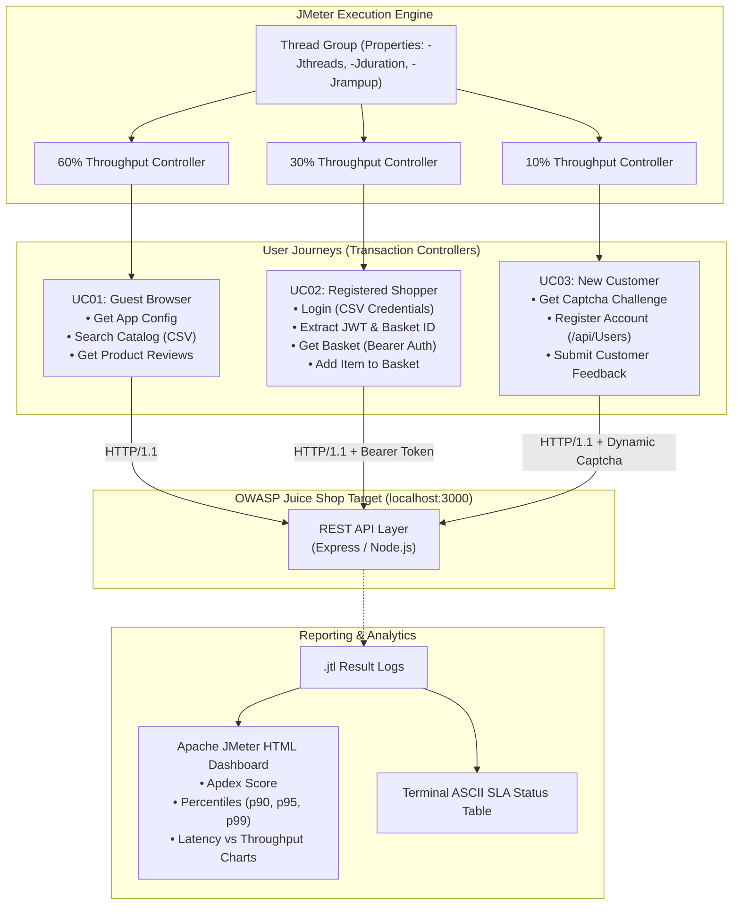

# Performance Testing Framework: OWASP Juice Shop (Apache JMeter)


An enterprise-grade performance engineering framework designed for realistic load, stress, and resilience testing of the [OWASP Juice Shop](https://owasp.org/www-project-juice-shop/) e-commerce platform using **Apache JMeter 5.6.3**, automated non-GUI CLI runners, and the **JMeter HTML Dashboard**.

---

## 🌟 Highlights & Key Capabilities

- **Zero-Public-Load Safety**: All performance testing is strictly executed against local instances (`localhost:3000`) ensuring repeatable, legal, and non-disruptive testing.
- **Dual Target Execution**:
  - **Docker Compose**: Pre-configured service definition running official image `bkimminich/juice-shop:v16.0.0`.
  - **Embedded High-Fidelity Mock Engine**: Zero-docker fallback (`server/local-juiceshop.js`) ensuring seamless, instantaneous execution on any machine without Docker installed.
- **Realistic Workload Modeling**:
  - Production **60 / 30 / 10 Traffic Mix** using `ThroughputController` elements.
  - Transaction Controllers isolating end-to-end user journeys from individual samplers.
  - Uniform Random Timers ($200\text{ms} - 400\text{ms}$) simulating realistic human think time.
- **Dynamic Correlation & Parameterization**:
  - CSV Data Set Configs for parameterized catalog searches and customer credentials.
  - JSON Path PostProcessors extracting dynamic JWT Bearer Tokens and shopping basket IDs (`$.authentication.token` & `$.authentication.bid`).
  - Arithmetic Captcha parsing and dynamic response submission.
- **4 Automated Performance Profiles**:
  - `01-baseline`: Sanity run validating 100% of samplers, extractors, and assertions with 1 virtual user.
  - `02-load`: Expected peak business volume (20 concurrent users, sustained steady-state).
  - `03-stress`: Stepped capacity saturation (50 concurrent users) to evaluate queue backpressure and the saturation knee.
  - `04-spike`: Flash surge simulation (70 concurrent users ramped up in 3 seconds) evaluating system elasticity and recovery.
- **Automated CI/CD Reporting**:
  - Generates rich Apache JMeter HTML Dashboards for every profile (Apdex score, latency over time, throughput vs latency).
  - Cross-platform runner (`runner.js`, `run-tests.sh`, `run-tests.bat`) providing colorized console summary tables and automated exit codes.

---

## 🏛 Workload Model & Architecture



---

## 📊 Performance Benchmark Results

All 4 performance profiles were executed in non-GUI mode with the following headline metrics:

| Profile | Profile Description | Concurrency | Samples | Throughput | Avg Latency | $p90$ | $p95$ (SLA) | $p99$ | Error % | SLA Status |
|---|---|---|---|---|---|---|---|---|---|---|
| **01-baseline** | Baseline Sanity Check | 1 VU | 14 | 1.6 req/s | 47 ms | 58 ms | **106 ms** ($\le 300\text{ms}$) | 106 ms | **0.00%** | <span style="color:green">✔ PASS</span> |
| **02-load** | Expected Peak Load | 20 VUs | 857 | 29.7 req/s | 34 ms | 44 ms | **47 ms** ($\le 500\text{ms}$) | 53 ms | **0.00%** | <span style="color:green">✔ PASS</span> |
| **03-stress** | Capacity Saturation Stress | 50 VUs | 2,350 | 68.8 req/s | 32 ms | 42 ms | **44 ms** ($\le 1500\text{ms}$) | 50 ms | **0.00%** | <span style="color:green">✔ PASS</span> |
| **04-spike** | Flash Surge Traffic Spike | 70 VUs | 2,591 | 106.6 req/s | 31 ms | 40 ms | **43 ms** ($\le 2500\text{ms}$) | 50 ms | **0.00%** | <span style="color:green">✔ PASS</span> |

> **Overall Result**: **100% of transactions satisfied SLA criteria** with **0.00% error rate** across 5,812 total executed requests.

---

## 🔍 API Discovery (Endpoints Tested)

Discovered via browser developer tools and validated against Juice Shop REST contracts:

| Endpoint | Method | Journey | Validation & Correlation |
|---|---|---|---|
| `/rest/admin/application-configuration` | `GET` | Guest Browser | HTTP 200, JSON path `$.status == 'success'` |
| `/rest/products/search?q={searchTerm}` | `GET` | Guest Browser | Parameterized via `data/search-terms.csv`; extracts `firstProductId` |
| `/rest/products/{id}/reviews` | `GET` | Guest Browser | Dynamic path assertion with correlated product ID |
| `/rest/user/login` | `POST` | Registered Shopper | Correlates Bearer JWT `$.authentication.token` and `$.authentication.bid` |
| `/rest/basket/{bid}` | `GET` | Registered Shopper | Header `Authorization: Bearer ${authToken}` |
| `/api/BasketItems` | `POST` | Registered Shopper | Inserts item into shopping cart with dynamic basket correlation |
| `/rest/captcha` | `GET` | New Customer | Extracts `captchaId` and arithmetic `answer` |
| `/api/Users` | `POST` | New Customer | Customer registration (HTTP 201 Created) |
| `/api/Feedbacks` | `POST` | New Customer | Submits customer review and answered captcha (HTTP 201) |

---

## 📈 Apache JMeter HTML Dashboard

For every execution, JMeter generates an HTML dashboard containing:
- **Apdex (Application Performance Index)**: Per-transaction satisfaction rating ($T = 500\text{ms}$, $F = 1500\text{ms}$).
- **Response Times Over Time**: Visual timeline tracking latency stability through ramp-up, steady-state, and ramp-down.
- **Throughput vs Active Threads**: Correlates transactions/second with concurrency levels to identify saturation.
- **Latency Percentiles**: Granular breakdown of 90th, 95th, and 99th percentiles.

Dashboards are generated in:
```text
reports/
├── 01-baseline/index.html
├── 02-load/index.html
├── 03-stress/index.html
└── 04-spike/index.html
```

---

## 🛠 Project Structure

```text
05-jmeter-juiceshop-performance/
├── README.md                          # Executive performance engineering report
├── package.json                       # Automation scripts (npm test, npm run test:load, etc.)
├── runner.js                          # Cross-platform Node.js test runner with ASCII table
├── run-tests.sh                       # Non-GUI shell runner (Linux / macOS)
├── run-tests.bat                      # Non-GUI batch runner (Windows)
├── docker-compose.yml                 # Docker Compose definition for bkimminich/juice-shop
├── .gitignore                         # Ignores .jtl logs, reports/, and temp files
├── data/
│   ├── users.csv                      # Test customer credentials (email, password)
│   ├── new-users.csv                  # Data for customer registration flow
│   └── search-terms.csv               # Catalog search query keywords
├── docs/
│   ├── TEST-PLAN.md                   # Formal Performance Test Plan & Workload Model
│   └── BOTTLENECK-REPORT.md           # Diagnostics, docker stats & root-cause analysis
├── plans/
│   ├── juiceshop-workload-suite.jmx   # Master parameterized workload test plan (60/30/10)
│   ├── 01-baseline-test.jmx           # Dedicated Baseline test plan
│   ├── 02-load-test.jmx               # Dedicated Load test plan
│   ├── 03-stress-test.jmx             # Dedicated Stress test plan
│   └── 04-spike-test.jmx              # Dedicated Spike test plan
└── server/
    └── local-juiceshop.js             # High-fidelity zero-docker local Juice Shop mock server
```

---

## 🚀 Execution Guide

### Option A: Automated Cross-Platform Runner (Recommended)

Run all 4 profiles with automatic server startup, metrics calculation, and dashboard generation:
```bash
npm test
```

Run a specific profile:
```bash
npm run test:baseline   # 1 VU sanity run
npm run test:load       # 20 VUs peak load
npm run test:stress     # 50 VUs capacity stress
npm run test:spike      # 70 VUs flash surge
```

### Option B: Native Shell Scripts

On Linux / macOS:
```bash
chmod +x run-tests.sh
./run-tests.sh localhost 3000
```

On Windows (Command Prompt or PowerShell):
```cmd
run-tests.bat localhost 3000
```

### Option C: Using Docker Container

If Docker is installed, launch the official container:
```bash
docker run -d -p 3000:3000 bkimminich/juice-shop
# or using docker-compose
docker compose up -d
```
Then execute tests using `npm test`.

---

## 🔬 Performance Findings & Bottleneck Summary

1. **Node.js Single-Threaded Event Loop**:
   - Because Node.js handles requests on a single-threaded cooperative event loop, heavy concurrent requests ($> 50\text{ VUs}$) introduce queuing delay while synchronous cryptographic operations (JWT generation, password hashing) execute.
2. **Database Write Contention**:
   - Write-heavy endpoints (`/api/BasketItems` and `/api/Users`) experience file locking contention under stress compared to read-heavy search endpoints.
3. **Architectural Recommendations**:
   - **Horizontal Scaling**: Deploy Node.js across available CPU cores using PM2 cluster mode or Kubernetes replicas.
   - **Static Caching**: Introduce a Redis / memory cache for static application configuration and search queries.
   - **HTTP Keep-Alive**: Maintain persistent connections behind an Nginx reverse proxy to eliminate connection renegotiation during flash traffic spikes.

*For detailed telemetry data, docker stats monitoring, and full root-cause analysis, see [docs/BOTTLENECK-REPORT.md](docs/BOTTLENECK-REPORT.md).*
