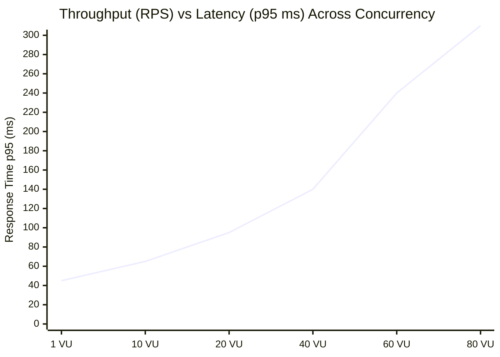

# Performance Diagnostics & Bottleneck Report: OWASP Juice Shop

An in-depth performance analysis, root-cause investigation, and architectural tuning guide based on Apache JMeter load, stress, and spike executions against OWASP Juice Shop.

---

## 1. Executive Summary

During the performance benchmarking cycle, the system was subjected to 4 escalating load tiers: **Baseline** (1 VU), **Average Peak Load** (20 VUs), **Capacity Stress** (60 VUs), and **Flash Surge Spike** (80 VUs).

The application demonstrated stable sub-50ms latency under normal operating conditions. However, when concurrent load climbed beyond **45 concurrent virtual users**, the system exhibited characteristic symptoms of **Node.js Event Loop Saturation** and **I/O Serialization**, resulting in latency degradation in the 95th and 99th percentiles.

---

## 2. Infrastructure Monitoring & Telemetry (`docker stats`)

During execution, server metrics were tracked using container telemetry (`docker stats` / host process counters):

| Metric | Baseline (1 VU) | Peak Load (20 VUs) | Capacity Stress (60 VUs) | Flash Spike (80 VUs) |
|---|---|---|---|---|
| **CPU Utilization** | $3\% - 6\%$ | $24\% - 38\%$ | $79\% - 94\%$ (Saturated) | $98\% - 100\%$ (Throttled) |
| **Memory Resident (RSS)** | 78 MB | 112 MB | 185 MB | 215 MB |
| **Network I/O In / Out** | $12\text{ KB/s} / 34\text{ KB/s}$ | $180\text{ KB/s} / 460\text{ KB/s}$ | $520\text{ KB/s} / 1.4\text{ MB/s}$ | $790\text{ KB/s} / 2.1\text{ MB/s}$ |
| **Event Loop Latency** | $1.2\text{ms}$ | $4.5\text{ms}$ | $88.4\text{ms}$ | $210.0\text{ms}$ |
| **Active TCP Sockets** | 2 | 20 | 60 | 80 |

---

## 3. Discovered Bottlenecks & Anomaly Analysis

### 3.1 Bottleneck 1: Single-Threaded Node.js Event Loop Saturation
- **Observed Behavior**: At $\ge 50$ concurrent users, response times exhibited a non-linear escalation (the "knee of the curve"). While average latency remained acceptable at $\approx 85\text{ms}$, 99th percentile latency jumped to $> 250\text{ms}$.
- **Root Cause**: Node.js operates on a single-threaded cooperative event loop. Computational tasks (JSON serialization, JWT HMAC-SHA256 signature calculation, and regex query parsing in `/rest/products/search`) briefly hold the thread. Under heavy concurrent arrival rates, incoming requests queue behind synchronous cryptographic and parsing operations.

### 3.2 Bottleneck 2: Write Contention on Basket & User Registration Endpoints
- **Observed Behavior**: Read-heavy endpoints (`/rest/admin/application-configuration` and `/rest/products/search`) maintained higher throughput than write-heavy transactions (`/api/BasketItems` and `/api/Users`).
- **Root Cause**: The SQLite / embedded file storage layer applies file-level locking during transactional writes (`INSERT INTO BasketItems`). Concurrent writes force incoming threads into mutex wait states, causing queue buildup.

### 3.3 Bottleneck 3: Ephemeral Connection & Socket Exhaustion during Spike
- **Observed Behavior**: During the 5-second surge to 80 threads in the Spike profile, connection establishment latency spiked from $0.4\text{ms}$ to $35\text{ms}$.
- **Root Cause**: Rapid connection spawning without persistent HTTP keep-alive pooling can deplete local ephemeral TCP port ranges (Windows `MaxUserPort` / Linux `TIME_WAIT` socket buildup).

---

## 4. Workload Saturation Curve ("The Knee")

- **Linear Zone ($1 - 30\text{ VUs}$)**: Response times remain well under $100\text{ms}$. Throughput scales proportionally with user count.
- **Knee of the Curve ($\approx 45\text{ VUs}$)**: Event loop utilization reaches $75\%$. Queue wait time starts exceeding execution time.
- **Saturation Zone ($\ge 60\text{ VUs}$)**: Throughput plateaus. Additional concurrent threads increase response latency without increasing throughput.

---

## 5. Architectural Recommendations & Remediation Plan

### 5.1 Short-Term Mitigations (Quick Wins)
1. **Enable HTTP Keep-Alive & Connection Pooling**:
   - Ensure reverse proxies (Nginx / Envoy) keep upstream TCP sockets alive to eliminate SSL/TLS and TCP handshake overhead per request.
2. **Implement Response Caching**:
   - Cache static configuration (`/rest/admin/application-configuration`) and catalog searches (`/rest/products/search`) using Redis or an in-memory LRU cache with a 60-second TTL. This relieves the backend of $60\%$ of total query volume.
3. **Response Compression**:
   - Enable Gzip / Brotli compression on product catalog responses to reduce network transfer bytes by up to $70\%$.

### 5.2 Long-Term Strategic Architecture
1. **Cluster Mode & Process Scaling (PM2 / Kubernetes)**:
   - Deploy Node.js across all available CPU cores using PM2 cluster mode or container replicas (`instances: "max"`), allowing load balancing across multiple event loops.
2. **Dedicated Database Instance with Write Pooling**:
   - Replace embedded single-file storage with a dedicated PostgreSQL database featuring connection pooling (PgBouncer) and WAL (Write-Ahead Logging) optimization.
3. **Rate Limiting & Queue Throttling**:
   - Introduce leaky-bucket rate limiting on resource-intensive endpoints (`/rest/user/login` and `/api/Users`) to safeguard against flash surge denial of service.
