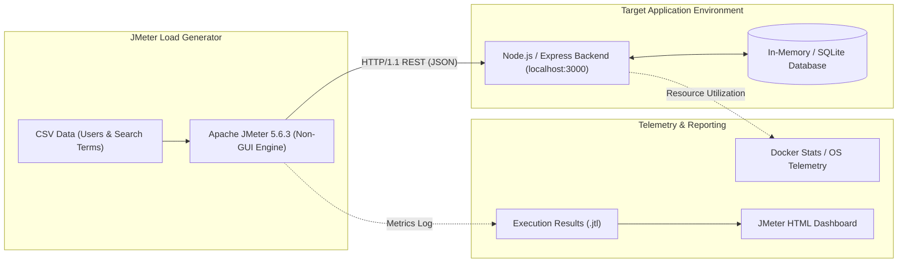
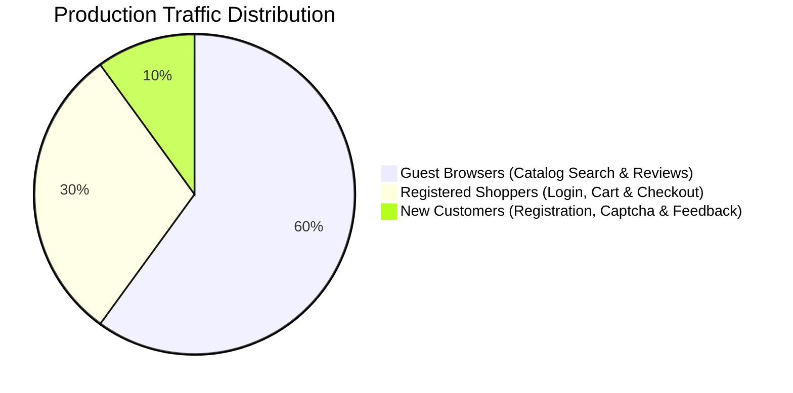

# Performance Test Plan: OWASP Juice Shop

An enterprise performance testing specification for the [OWASP Juice Shop](https://owasp.org/www-project-juice-shop/) application using **Apache JMeter 5.6.3**, automated non-GUI execution, and the **JMeter HTML Dashboard**.

---

## 1. Executive Summary & Purpose

The objective of this performance test campaign is to evaluate the stability, responsiveness, resource utilization, and throughput thresholds of the OWASP Juice Shop e-commerce platform under distinct operational load profiles. Testing is conducted strictly against a local containerized or local emulated instance (`localhost:3000`) to guarantee legal, safe, and reproducible benchmarking without placing unwanted traffic on public servers.

---

## 2. Core Performance Concepts & Metrics

### 2.1 Test Profile Types
- **Baseline (Sanity) Test**: A single-user, single-iteration validation verifying that 100% of HTTP samplers, JSON Path extractors, token correlations, and assertions function without regressions.
- **Load Test**: Evaluates application performance under expected peak production traffic (20 concurrent users, realistic think time, 60-second steady-state) to establish normal operational response time percentiles and throughput.
- **Stress Test**: Gradually pushes system concurrency beyond anticipated peaks (60 virtual users, reduced think time) to discover the saturation "knee of the curve", queue backpressure, and the breaking point.
- **Spike Test**: Evaluates system resilience and recovery by subjecting the application to an instantaneous burst of traffic (80 virtual users ramped up in only 5 seconds) simulating a flash sale or promotional campaign.
- **Soak (Endurance) Test**: Evaluates memory leaks, thread contention, and connection pool exhaustion over an extended operational duration.

### 2.2 Key Performance Indicators (KPIs)
- **Response Time Percentiles ($p90, p95, p99$)**:
  - $p90$: 90% of requests completed faster than this duration.
  - $p95$: 95% of requests completed faster than this duration (primary SLA benchmark).
  - $p99$: 99% of requests completed faster than this duration (identifies latency tail & garbage collection outliers).
- **Throughput (Transactions/Requests Per Second - TPS/RPS)**: The volume of completed business transactions serviced by the backend per unit of time.
- **Error Rate (%)**: Percentage of failed transactions relative to total requests ($\frac{\text{Failed Requests}}{\text{Total Requests}} \times 100\%$).
- **Apdex (Application Performance Index)**: Standardized customer satisfaction index ($T = 500\text{ms}$, $F = 1500\text{ms}$).

---

## 3. Architecture & Target Environment

- **Target Host**: `localhost` (Configurable via `-Jhost=...`)
- **Target Port**: `3000` (Configurable via `-Jport=...`)
- **Protocol**: `HTTP/1.1`
- **Application Engine**: OWASP Juice Shop (`docker run -d -p 3000:3000 bkimminich/juice-shop`) with zero-docker fallback via `server/local-juiceshop.js`.

---

## 4. API Discovery & Endpoints Catalog

Discovered and validated via Chrome DevTools Network inspection and OpenAPI specification:

| # | HTTP Method | Endpoint Path | Description | Key Headers / Payload |
|---|---|---|---|---|
| 01 | `GET` | `/rest/admin/application-configuration` | Retrieves runtime application config & branding | `Accept: application/json` |
| 02 | `GET` | `/rest/products/search?q={term}` | Searches product catalog by keyword | Dynamic search query parameter |
| 03 | `GET` | `/rest/products/{id}/reviews` | Retrieves customer reviews for a given product | Extracted dynamic product ID |
| 04 | `POST` | `/rest/user/login` | Authenticates user; returns JWT token & basket ID | `{"email":"...","password":"..."}` |
| 05 | `GET` | `/rest/basket/{bid}` | Retrieves customer shopping cart contents | `Authorization: Bearer <token>` |
| 06 | `POST` | `/api/BasketItems` | Adds product quantity to basket | `{"ProductId":1,"BasketId":"...","quantity":1}` |
| 07 | `GET` | `/rest/captcha` | Fetches dynamic arithmetic security captcha | Returns `captchaId` & `answer` |
| 08 | `POST` | `/api/Users` | Registers a new customer account | `{"email":"...","password":"...","securityQuestion":{...}}` |
| 09 | `POST` | `/api/Feedbacks` | Submits customer review and captcha answer | `{"comment":"...","rating":5,"captchaId":"...","captcha":"..."}` |

---

## 5. Workload Model & Traffic Distribution

The workload model accurately reflects production e-commerce visitor behavior using a **60 / 30 / 10 Traffic Mix** implemented via JMeter `ThroughputController` elements within a unified thread group:

### 5.1 Journey 1: Guest Browser (60% Traffic Share)
- **Objective**: Simulates anonymous visitors researching products.
- **Transactions**:
  1. `UC01_01_GetAppConfig`: Request `/rest/admin/application-configuration`.
  2. `Think Time`: Uniform Random Timer ($200\text{ms} - 400\text{ms}$).
  3. `UC01_02_SearchCatalog`: Request `/rest/products/search?q=${searchTerm}` parameterized with `data/search-terms.csv`. Extract first product ID (`firstProductId`).
  4. `Think Time`: Uniform Random Timer ($200\text{ms} - 400\text{ms}$).
  5. `UC01_03_GetProductReviews`: Request `/rest/products/${firstProductId}/reviews`.

### 5.2 Journey 2: Registered Shopper (30% Traffic Share)
- **Objective**: Simulates authenticated buyers actively purchasing items.
- **Transactions**:
  1. `UC02_01_UserLogin`: Authenticate against `/rest/user/login` with credentials from `data/users.csv`. Correlate `authToken` (`$.authentication.token`) and `userBasketId` (`$.authentication.bid`).
  2. `Think Time`: Uniform Random Timer ($200\text{ms} - 400\text{ms}$).
  3. `UC02_02_GetUserBasket`: Request `/rest/basket/${userBasketId}` with `Authorization: Bearer ${authToken}`.
  4. `Think Time`: Uniform Random Timer ($200\text{ms} - 400\text{ms}$).
  5. `UC02_03_AddBasketItem`: Submit item to `/api/BasketItems` with correlated token and basket ID.

### 5.3 Journey 3: New Customer (10% Traffic Share)
- **Objective**: Simulates onboarding of new visitors and review submissions.
- **Transactions**:
  1. `UC03_01_GetCaptcha`: Request `/rest/captcha`. Extract `captchaId` and `captchaAnswer`.
  2. `Think Time`: Uniform Random Timer ($200\text{ms} - 400\text{ms}$).
  3. `UC03_02_RegisterUser`: Post user registration payload to `/api/Users` with timestamped email.
  4. `Think Time`: Uniform Random Timer ($200\text{ms} - 400\text{ms}`).
  5. `UC03_03_SubmitFeedback`: Post feedback payload to `/api/Feedbacks` with captcha validation.

---

## 6. Service Level Agreements (SLAs) & Acceptance Criteria

| Load Profile | Virtual Users | Ramp-up | Steady State | Target 95th Percentile ($p95$) | Max Allowed Error Rate | Acceptance Criteria |
|---|---|---|---|---|---|---|
| **01 Baseline** | 1 | 1s | 10s | $\le 300\text{ms}$ | 0.00% | 100% samplers & correlations pass |
| **02 Peak Load** | 20 | 15s | 60s | $\le 500\text{ms}$ | $\le 1.00\%$ | Steady-state throughput without degradation |
| **03 Stress Test** | 60 | 25s | 90s | $\le 1500\text{ms}$ | $\le 5.00\%$ | Identify saturation knee & queue latency |
| **04 Flash Spike** | 80 | 5s | 45s | $\le 2500\text{ms}$ | $\le 10.00\%$ | Rapid recovery post-surge within 15s |

---

## 7. Test Data Management & Correlation Rules

1. **User Credentials (`data/users.csv`)**:
   - Iterated linearly per virtual user thread (`recycle=true`, `stopThread=false`).
   - Avoids concurrency lockouts and simulates distinct user sessions.
2. **Search Keywords (`data/search-terms.csv`)**:
   - Dynamic catalog queries (`apple`, `orange`, `banana`, `lemon`, `juice`, `hoodie`, `sticker`, etc.) to prevent static database cache hits.
3. **Correlation Extraction**:
   - **JWT Bearer Token**: Extracted via JSON Path `$.authentication.token` and injected into HTTP Header Manager (`Authorization: Bearer ${authToken}`).
   - **Basket ID**: Extracted via JSON Path `$.authentication.bid` and passed in `/rest/basket/${userBasketId}` and `/api/BasketItems`.
   - **Captcha ID & Answer**: Extracted via `$.captchaId` and `$.answer` and passed in feedback submission.
